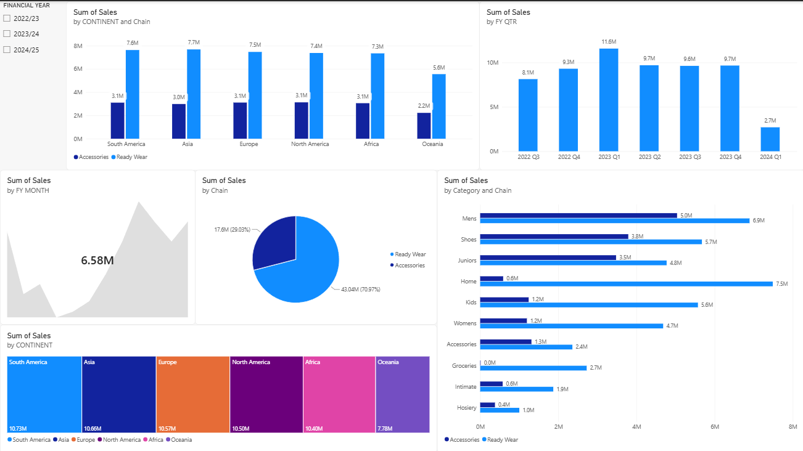

# Sales Performance Analysis Dashboard | Power BI

An interactive Microsoft Power BI dashboard developed to analyze sales performance across financial years, fiscal quarters, months, continents, product categories, and business chains.

The project demonstrates an end-to-end BI workflow using Microsoft Excel, Power Query, data modeling, DAX, and Power BI visualizations.

## Dashboard Preview



## Project Objectives

- Analyze sales performance across financial years, quarters, and months.
- Compare sales across continents and countries.
- Understand the contribution of each business chain.
- Compare product-category performance across business chains.
- Present sales information through an interactive dashboard.

## Data Sources and Model

The project uses an Excel workbook containing three tables:

| Table | Purpose |
|---|---|
| `Sales_Table` | Contains the sales transaction data and related business fields. |
| `Country_Mapping_Table` | Maps countries to their respective continents. |
| `Date_Mapping_Table` | Provides date-related attributes, including financial year, financial quarter, and financial month. |

The tables were connected in the Power BI data model so that sales could be analyzed using geographic and financial-calendar attributes.

## Data Preparation

Power Query was used to prepare the source data and create the following fields, which were unavailable in the original source in the required form:

- Cost
- Profit
- Sales

The calculation logic should be documented alongside the actual source columns and business rules when the workbook is prepared for publication.

## Data Modeling and DAX

The data model connects:

- `Sales_Table` with `Country_Mapping_Table` to support country- and continent-level analysis.
- `Sales_Table` with `Date_Mapping_Table` using the invoice-date relationship to support financial-year, quarter, and month analysis.

DAX was also used during report development. The specific DAX measures and calculated columns should be listed here with their expressions when documented from the Power BI file.

> Note: Relationships are configured in Power BI's Model view. DAX is used for calculations such as measures and calculated columns; a relationship itself is not a DAX formula.

## Dashboard Features

The report includes the following visuals and interactive elements:

1. **Financial Year Slicer** — filters the report by financial year (2022/23, 2023/24, and 2024/25).
2. **Sales by Continent and Chain** — compares Ready Wear and Accessories sales across continents.
3. **Sales by Financial Year Quarter** — presents quarterly sales performance.
4. **Sales by Financial Year Month** — presents monthly sales information.
5. **Sales by Chain** — compares the contribution of Ready Wear and Accessories.
6. **Sales by Continent** — presents the distribution of sales across continents.
7. **Sales by Category and Chain** — compares product-category sales across the two chains.

## Selected Observations

The following observations are based on the dashboard screenshot included in this repository. Values reflect the displayed report state and are rounded as shown in the visuals.

- Ready Wear contributes **43.04M (70.97%)** of sales by chain.
- Accessories contributes **17.60M (29.03%)** of sales by chain.
- **2023 Q1** is the highest displayed quarter, with **11.6M** in sales.
- South America displays **10.73M**, while Oceania displays **7.78M** in continent-level sales.

## Tools and Technologies

- Microsoft Excel
- Power Query
- Microsoft Power BI Desktop
- DAX (Data Analysis Expressions)
- Data Modeling and Data Visualization

## Repository Structure

```text
power-bi-sales-analysis-dashboard/
├── assets/
│   └── dashboard-preview.png
├── data/
│   └── sales-data.xlsx
├── report/
│   └── sales-analysis-dashboard.pbix
└── README.md
```

Replace the example Excel and PBIX filenames above with your actual filenames when you add them to the repository.

## How to Use

1. Download or clone this repository.
2. Open `report/sales-analysis-dashboard.pbix` using Microsoft Power BI Desktop.
3. If Power BI cannot locate the Excel source, update the workbook path in Power Query or Data source settings.
4. To refresh the report, make sure the Excel workbook is available at the configured source path, then select **Refresh** in Power BI Desktop.

## Data and Privacy Notice

Before making this repository public, confirm that you have permission to publish the Excel workbook and its contents. Remove or anonymize confidential business information, personal information, and any restricted records. If the original data cannot be shared, publish a sanitized or synthetic sample dataset and explain that limitation here.
